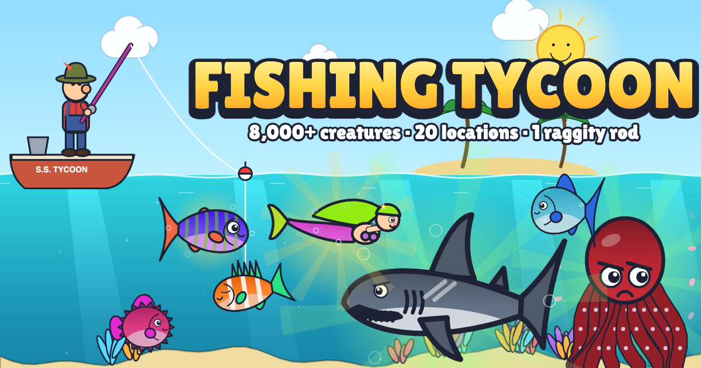

# 🎣 Fishing Tycoon

A cartoony fishing tycoon game that runs in the browser. You start at a muddy pond with a **Raggity Old Stick** and a **Dried Mealworm**, where the best thing in the water is a catfish. Catch creatures, sell them, and buy better rods, bait and fishing spots until you're hauling Poseidon out of the Cosmic Ocean.



## How to play

1. **Hold** anywhere (mouse, touch or Space) to charge your cast, then let go. More power means a deeper cast, up to your rod's reach.
2. When the **!** pops up, tap fast to set the hook.
3. **Hold to reel** and keep the green bar on the fish until the meter fills.
4. Sell your catches from the **Bucket** and spend the money in the **Shop** and on **Travel**.

## What's in it

- **8,000+ procedurally generated species**, every one drawn and animated in code with its own colors, pattern, fins and swim style
- **20 locations**: Muddy Pond, Babbling River, Swampy Bayou, Misty Mountain Lake, Amazon River, Sandy Beach Pier, Mangrove Lagoon, Coral Reef, Kelp Forest, Rocky Harbor, Arctic Ice Sea, Tropical Islands, Open Ocean, Shipwreck Cove, Volcanic Vents, Bermuda Triangle, Lost City of Atlantis, North Pole Sea, Mariana Trench and the Cosmic Ocean
- **45 rods**: longer rods reach deeper water and stronger rods hold heavier catches. If a catch is too heavy, the line snaps.
- **45 baits**: better bait raises your luck, makes fish bite faster and improves your Fabled odds
- **Creatures**: fish, eels, sharks, whales, dolphins, octopi, squid, crabs, lobsters, starfish, seahorses, sea sponges, sea snails, sea urchins, sea lions, sea spiders, plankton, coral, manatees, barnacles, and junk like old boots
- **Fabled legends** (about a 0.01% chance with starter gear): Megalodon, Mermaid, Kraken, Poseidon, Bubble Buddy, Plesiosaurus, Santa Claus, UFO, Alien, Aquaman, Loch Ness Monster, Mosasaurus, Dunkleosteus and more
- **7 rarities**: Common, Uncommon, Rare, Epic, Legendary, Mythic and Fabled
- **Frenzy Fish** (about 2% of bites, anywhere): catching one makes everything you catch for a short time worth more money. Lucky ×1.5 is common, then Golden ×5, Ruby ×10, Diamond ×50, Cosmic ×100, and the extremely rare Mega Frenzy Fish at ×1000. Better bait makes the big ones less rare.
- **5 nets** ($900 to $2B) that haul up 3, 5, 10, 20 or 25 creatures in one throw, with a 45-second recharge. A Frenzy Fish caught in a net doesn't start a frenzy; it makes every creature in that haul worth 1.5×.
- **Live bait**: put a small fish from your Bucket on the hook for extra luck and bigger bites for a few casts. Big, rare, spiky or venomous creatures can't be used as bait.
- **Beat the game**: own every rod, bait, net and location to become Champion Angler, then reset and play again (you keep your 🏆 trophy count)
- A **Fishdex** that tracks every species you've discovered
- Progress saves automatically in your browser

## Run locally

It's a static site with no build step:

```bash
python3 -m http.server 5173
```

Then open http://localhost:5173.

`tools/icon.html` renders the app icon (`?mode=icon`) and the thumbnail (`?mode=thumb`) with the game's own art engine. `tools/gallery.html` shows one of every creature type.
